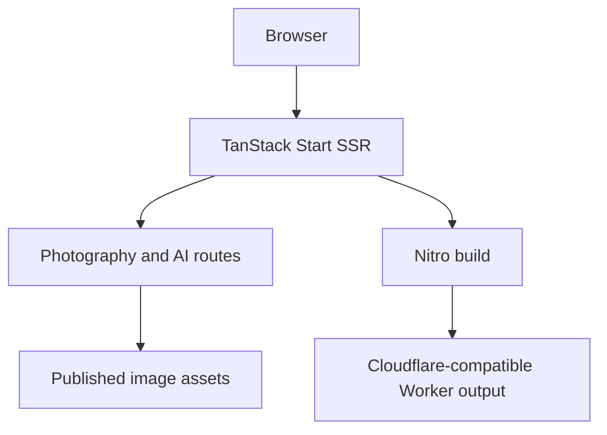

CHEFO — VISUAL WORLDS

<strong>Real places. Endless worlds.</strong>

  
  
  

  
  
  
  

CHEFO — VISUAL WORLDS is a bilingual editorial portfolio by photographer and AI image creator Stefan Badev. It brings real travel photography and constructed visual stories into one experience. The same person moves between documented places and imagined roles; the site gives each kind of image its own context rather than presenting one undifferentiated gallery.
Publication status: The project has been merged into main and verified locally. A public production deployment and final hosting choice are still pending. This README intentionally does not link to a nonexistent live site.

📑 Contents
- The idea
- Explore the site
- Photography
- AI Worlds
- Editorial and interaction design
- Technology and architecture
- Run locally
- Image assets and quality checks
- Hosting and project status
- Author
✨ The Idea
Real places	Imagined worlds
Photographs made while traveling: observed moments, cities, atmosphere, and personal perspective.	AI-assisted portraits and scenes that place a recognizable protagonist into new cultures, genres, and stories.

The home page introduces that dual identity through the Sunny Beach 2025 / 2126 hero: a real coastal photograph meets a speculative view of the same place a century later. From there, visitors can follow the photography, enter the AI collections, or learn more about the person behind both.

The site is an image-led personal portfolio. It is not an online store, a stock-photo catalog, or a generic agency template.
🧭 Explore the Site
Area	What visitors can do
Home	Experience the Sunny Beach past/future hero and follow selected entries into the portfolio.
Photography	Browse ten travel albums, including Paris and Istanbul.
AI Worlds	Explore four themed collections containing 16 works each.
Artwork view	Open images in a lightbox and move between works.
About	Read about the creator and switch between a real photograph and an AI version.
BG / EN	Read the site in Bulgarian or English.

The design was reviewed at desktop and mobile widths; navigation, collection browsing, image loading, lightbox, and the About toggle were exercised during local acceptance checks.
📷 Photography
Photography is the documentary half of Visual Worlds. The ten albums are meant to be explored as sequences: the cover introduces a place, and the grid builds rhythm through changing scale, composition, and detail.

Paris and Istanbul received dedicated desktop and mobile reviews during development. The full Photography area includes the remaining accessible albums, their covers, mosaics, and individual image views.
The visitor journey

The work should stand on the image itself. Titles and short editorial copy provide a point of view instead of listing objects already visible in the frame.
🎭 AI Worlds
Four collections · sixteen works per collection · sixty-four works in total. These are visual stories, not a set of interchangeable profile pictures. Each collection has a different premise, while the central identity remains recognizable.
Around the World
Travel portraits place Chefo in different cultural settings. The intended visual standard is a believable editorial photograph: a recognizable face, natural light, a credible location, and a calm human presence. Captions should add a thought about the place or the moment instead of describing clothing and background objects.
Cinema Archetypes
Genre scenes turn the protagonist into characters caught inside an event. Expression and body language matter as much as costume or environment. Action images need to communicate stakes and emotion rather than look like static promotional portraits.

The other two collections are part of the four-collection site. Their exact titles and artwork lists should be taken from the current source before naming them in this README; this draft does not invent labels or image-generation providers.
Artwork presentation
- Collection pages organize works as coherent series.
- Individual works can be opened at a larger scale in the lightbox.
- Titles and descriptions exist in Bulgarian and English.
- Provider labels are attributed per work where the site displays them; they should not be generalized across an entire collection.
✍️ Editorial and Interaction Design
Principle	How it appears in the site
Image first	Photography and AI work lead; text gives context without narrating the obvious.
Two languages	Main navigation, section copy, titles, and artwork descriptions have BG/EN variants.
Consistent identity	The person in AI Worlds remains recognizable across places and roles.
Responsive layout	Desktop compositions adapt to narrow mobile screens and a mobile menu.
Focused viewing	The lightbox lets visitors look at individual works without losing the collection.
Clear authorship	About connects the real photographer and the imagined persona.

The bilingual copy is editorial rather than a mechanical word-for-word translation. In Around the World, the desired caption voice is brief and personal: a moment, the character of a place, and one unexpected thought.
🧰 Technology and Architecture
Layer	Technology	Responsibility
Application	TanStack Start, React, TypeScript	Routing, components, and server rendering
Tooling	Vite, npm	Development and production build
Styling	Tailwind CSS and application styles	Layout, typography, and responsive design
Server output	Nitro cloudflare-module preset	Worker-compatible SSR artifact
Verification	Vitest and editorial guards	Checks for content, image references, and UI behavior

This is an SSR application, not a static-only Vite export. The successful isolated production build generated a Nitro Worker module with public assets. A local Wrangler run confirmed that representative BG/EN routes and image assets served successfully. The hosting platform has not yet been selected for production.
💻 Run Locally
The commands below describe the npm workflow used for the clean build validation. Run them from the project root after cloning the repository.
npm ci
npm run dev
Open the local address printed by the development server. Earlier project reviews used http://localhost:8080/; the actual port depends on the current local command and configuration.

To create a fresh production artifact:
npm run build
The build runs the Vite/Nitro pipeline and the repository’s postbuild editorial-string guard. The repository currently tracks both package-lock.json and bun.lock; npm was the package manager used for the isolated clean-build check. A single official package-manager policy remains a separate maintenance task.
Production preview note: A prior vite preview attempt expected dist/server/server.js, while the fresh Nitro build emitted .output/server/index.mjs. Do not treat vite preview as a verified production smoke test for this artifact. The Worker was checked locally through Wrangler instead.

🖼️ Image Assets and Quality Checks
The portfolio carries its visual content as part of the application, including optimized display images and original PNG masters used by some tests. Two image guards read 35 test-required PNG masters to verify the relationship between published WebP files and their source assets. These masters were deliberately included in the reviewed checkpoint.

The project has also been checked for missing images, failed requests, horizontal overflow, and runtime exceptions on representative desktop and mobile views. The final pre-merge acceptance run covered 24 browser scenarios and five interactions, including the mobile menu, collection navigation, lightbox, and About toggle.

These checks describe the reviewed local version. A production deployment should receive a fresh smoke test on its actual URL and a real-device mobile review.
🌍 Hosting and Project Status
Item	Current state
Reviewed feature work	Merged into main with a normal merge commit; checkpoint history preserved.
Clean production build	Passed in an isolated npm install.
Local Worker	Passed representative SSR, BG/EN, CSS, JS, Photography, and AI image requests.
Production hosting	Not connected; no public deployment yet.
Cloudflare Workers	Current Nitro output was verified locally through Wrangler.
Vercel	Remains an option; it requires its own Nitro preset/build artifact and verification.

The initial public URL will be added here after the host is selected and a production deployment is tested. The existing .output from an older experiment must not be reused for deployment; build a fresh artifact from the reviewed source.
Known follow-up work
- A data-reveal hydration warning has been documented; the reviewed pages did not show a visible or functional failure from it.
- Existing Prettier formatting debt is tracked separately from content and design changes.
- The Around the World captions and selected AI images can continue to receive editorial review without changing the architecture.
- Final production checks should cover BG/EN routes, image loading, navigation, lightbox, mobile widths, and Worker CPU usage under the chosen host.
👤 Author
Stefan Badev (Chefo) — photography, AI imagery, editorial direction, and the Chefo Visual Worlds project.

The portfolio is organized around a simple question: What changes when the same person moves between a real place and an imagined world?

<strong>CHEFO — VISUAL WORLDS</strong> Real places. Endless worlds.

