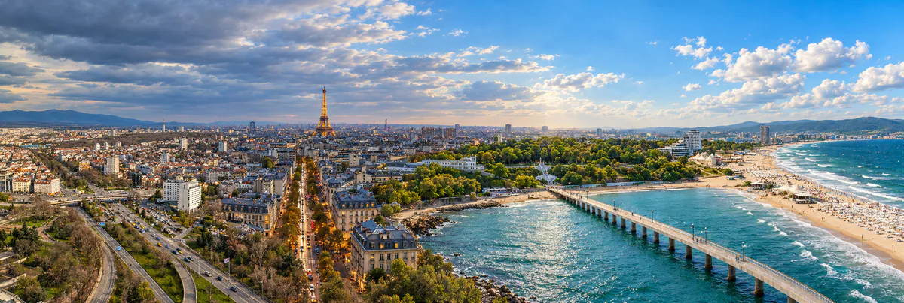

# 📸 CHEFO — Visual Worlds

### Real places. Endless worlds.

[](#-technology-stack)
[](#-technology-stack)
[](#-technology-stack)
[](#-technology-stack)
[](#-site-map)
[](#-project-status)

**CHEFO — Visual Worlds** is the personal portfolio of **Stefan Badev (Chefo)**. It brings together **original travel photography** and **AI-generated visual stories** in a bilingual, server-rendered web application.

The photography archive documents places Stefan has visited, from the Bulgarian Black Sea coast to Paris and Istanbul. In the AI collections, he steps into the frame as the recurring subject, taking on different characters across historical eras, professions, cinematic scenes, and destinations around the world.



*The Photography cover combines six destinations in one panoramic collage.*

---

## ✨ Highlights

- 📷 **13 travel albums** with individual covers, curated photo sequences, and dedicated album pages.
- 🗺️ **Interactive travel passport** with album previews and destination stamps.
- 🎭 **64 AI artworks across four collections**, with dedicated collection and artwork pages.
- ↔️ **Same Place, Another Time** — a draggable comparison between photographs of real locations and AI-generated interpretations set in another era.
- 🔍 **Shared lightbox** for photography and AI artwork, with zoom, pan, keyboard navigation, swipe, and pinch gestures.
- 🌐 **Bulgarian and English** across navigation, routes, and editorial content.
- 📱 **Responsive layouts** with desktop and touch interactions and support for reduced motion.

---

## 🧭 Site Map

| Section | Bulgarian | English | What you can explore |
| --- | --- | --- | --- |
| **Home** | `/` | `/en/` | The opening portrait, selected photo albums, featured AI works, and an introduction to the creator. |
| **Photography** | `/photography/` | `/en/photography/` | Travel albums, the interactive passport, and a filterable All Photos gallery. |
| **AI Worlds** | `/ai-worlds/` | `/en/ai-worlds/` | The real/AI comparison, four curated collections, and the All Works gallery. |
| **About** | `/about` | `/en/about` | The story behind the project and a portrait switch between a photograph and an AI version. |

---

## 📷 Photography

The archive is organized by destination. Each album has a cover and a curated sequence of photographs. The main Photography page offers two ways to browse:

- **Albums** — choose a destination, preview photographs from that album, and open its dedicated page. As you explore the destinations, the travel passport collects their stamps.
- **All Photos** — browse photographs across the archive and narrow the gallery by theme.

| Country | Albums |
| --- | --- |
| **Bulgaria** | Sofia, Sunny Beach, Sveti Vlas, Nessebar, Burgas, Plovdiv, Rila |
| **France** | Paris, Lyon |
| **Türkiye** | Istanbul, Edirne, Bodrum |
| **Tunisia** | Tunisia |

---

## 🎭 AI Worlds

The AI gallery is organized into **four collections of 16 works each**. A recognizable protagonist connects the series. Wardrobe, setting, lighting, and composition change with the role or place.

| Collection | Focus |
| --- | --- |
| **Historical Eras & Rulers** | Portraits inspired by historical figures, period clothing, and symbols of power. |
| **Professions & Roles** | Character studies shaped by the tools, clothing, and environments of different occupations. |
| **Cinema Archetypes** | Film-inspired scenes that use light, movement, and composition to suggest a larger story. |
| **Around the World** | Portraits set across 16 destinations, drawing on local architecture, clothing, and atmosphere. |

Visitors can explore a collection in its curated order or switch to **All Works** and filter by collection. Individual artwork pages provide editorial context and navigation to adjacent works.

---

## ↔️ Same Place, Another Time

A draggable divider reveals a real scene on the left and an AI interpretation on the right. The comparison works with a mouse, touch, or keyboard.

| Location | Photographic scene | AI interpretation |
| --- | --- | --- |
| **Sofia** | Largo Square | The same square reimagined in 2200. |
| **Istanbul** | Ortaköy on the Bosphorus | An interpretation of Constantinople around 1450. |
| **Paris** | The Eiffel Tower seen from Trocadéro | Paris during the 1900 World’s Fair. |

---

## 🖼️ Image Viewing

Photographs and artworks use a shared lightbox. Visitors can move between images, zoom in, and pan around the enlarged frame. Touch controls support swiping between images and pinching to zoom. Keyboard controls support browsing and closing the viewer.

The Photography cover uses two WebP sizes. The main galleries and the real/AI comparison use images stored alongside the project.

---

## 🏗️ Architecture

TanStack Start renders the application on the server. File-based routes connect the Bulgarian and English URLs to shared React views. Typed content modules define albums, photographs, collections, and artwork records. Shared components provide navigation, the lightbox, and the interactive comparison.

```text
chefo-visual-worlds/
├── public/
│   ├── covers/          # Responsive Photography cover images
│   └── worlds/          # Paired images for the real/AI comparison
├── scripts/             # Development guard, editorial validation, browser checks
├── src/
│   ├── components/      # Shared UI, galleries, lightbox, and comparison controls
│   ├── content/         # Typed albums, photographs, collections, and artworks
│   ├── i18n/            # Bulgarian and English messages and localized links
│   ├── routes/          # File-based routes and page metadata
│   ├── views/           # Shared page views
│   └── server.ts        # Server entry and SSR error handling
└── package.json
```

---

## 🧰 Technology Stack

| Layer | Technology |
| --- | --- |
| Web framework and routing | TanStack Start, TanStack Router |
| UI and types | React 19, TypeScript |
| Styling and build tooling | Tailwind CSS 4, Vite |
| Server rendering and packaging | Nitro |
| Production build target | Cloudflare Worker module |
| Automated testing | Vitest, Testing Library |
| Project-specific validation | Editorial checks, mobile layout checks, and section navigation checks |

---

## 🚀 Local Development

You’ll need **Git**, **Node.js**, and **npm**. Clone the repository, install dependencies, and start the development server:

```bash
git clone https://github.com/s-badev/chefo-visual-worlds.git
cd chefo-visual-worlds
npm ci
npm run dev
```

Open the address printed by Vite.

### Development checkout guard

In the primary checkout, `npm run dev` runs a Git guard before Vite starts. The guard requires `main` and attempts a fast-forward-only pull when the checkout is behind `origin/main`. Linked Git worktrees skip the guard. The guard can also be bypassed in CI or with `CHEFO_SKIP_GUARD=1`.

---

## 🧪 Verification

| Check | Command |
| --- | --- |
| TypeScript | `npx tsc --noEmit` |
| Test suite and editorial source validation | `npm test -- --maxWorkers=1` |
| Production build and post-build editorial validation | `npm run build` |

The test script runs an editorial source check before Vitest. The production build runs a separate check on its output. The repository also provides browser scripts for reviewing mobile layouts and section navigation.

### Quick Review Guide

1. **Home** — follow both primary links and check that they lead to Photography and AI Worlds.
2. **Photography** — preview several albums and confirm that the active destination, image, caption, and thumbnails agree. Switch to All Photos, apply a theme filter, and open a photograph.
3. **AI Worlds** — try the comparison for Sofia, Istanbul, and Paris. Open a collection, navigate between artworks, and filter the All Works gallery.
4. **About** — switch between the photographic and AI portrait.
5. **Responsive and bilingual review** — repeat the main paths in Bulgarian and English. Check the mobile menu, touch gestures, keyboard focus, and reduced-motion behavior.

---

## ✅ Project Status

| Item | Status |
| --- | --- |
| Photography archive and destination albums | Implemented |
| AI collections and individual artwork pages | Implemented |
| Real/AI comparison, travel passport, and lightbox | Implemented |
| Bulgarian and English routes | Implemented |
| Production build and local Worker preview | Previously verified with representative pages and images |
| Public deployment | **Pending** |

---

## 👤 Author

**Stefan Badev (Chefo)** — photography, AI imagery, and editorial direction.

[GitHub profile](https://github.com/s-badev)
